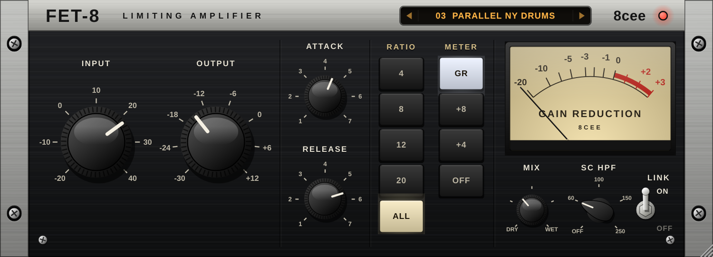
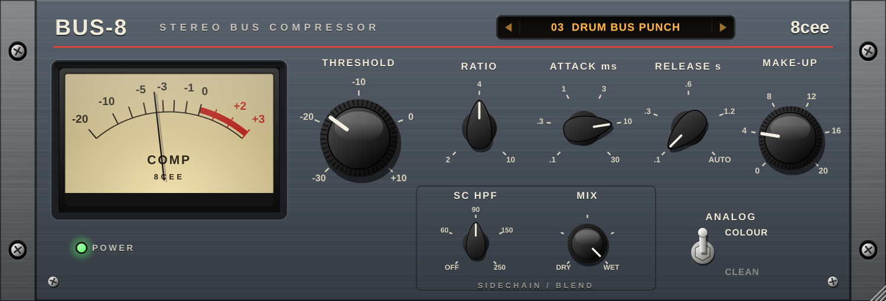
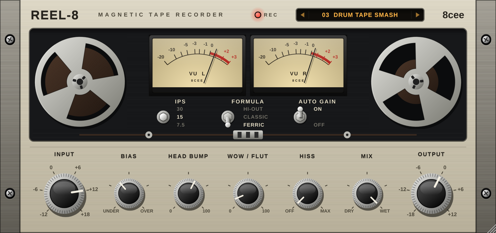

# 8cee Vintage — FET-8 · Bus-8 · Reel-8

Three analog-style mixing plug-ins by **8cee**, built with JUCE. VST3 on Windows and macOS, plus AU and standalone apps on macOS.

| | |
|---|---|
|  | **FET-8 Limiting Amplifier** — fast FET-style peak compressor. Input drives into a fixed threshold, output sets level (classic workflow). Attack 20–800 µs, release 50–1100 ms with program-dependent recovery, ratios 4 / 8 / 12 / 20 and **ALL** (all-buttons-in over-compression). FET distortion grows with gain reduction, output-transformer colour, sidechain HPF, stereo link, parallel mix. |
|  | **Bus-8 Stereo Bus Compressor** — VCA "glue" compressor. Threshold, stepped ratio 2 / 4 / 10, attack .1–30 ms, release .1–1.2 s or **AUTO** (fast after transients, slow on sustained material), make-up, sidechain HPF, mix and an Analog Colour switch. Linked stereo, soft knee. |
|  | **Reel-8 Magnetic Tape Recorder** — 7.5 / 15 / 30 ips, three tape formulas (Ferric, Classic, Hi-Output), bias (under/over), head bump, HF loss, wow & flutter, hiss, mix, auto gain. Hysteresis-style saturation with pre/de-emphasis so highs compress like real tape. The reels turn while audio is running. |

All three: 2× oversampling where the saturation lives (FET-8, Reel-8), phase-coherent dry/wet, VU meters with real ballistics, resizable vector UI (50–200 %), double-click any knob to reset.

## Presets

Each plug-in has 12 factory presets. Click the amber display at the top of the faceplate for the list, or use its arrows or the mouse wheel to step through them. A `*` means you've tweaked it since loading; the menu then offers "Revert". Your DAW also sees them as programs. Your own settings are saved with the project.

| FET-8 | Bus-8 | Reel-8 |
|---|---|---|
| Init | Init | Init |
| Drum Bus Smash | Mix Bus Glue | Mix Bus Glue |
| Parallel NY Drums | Drum Bus Punch | Warm 15 IPS |
| Kick Punch | Boom Bap Pump | Drum Tape Smash |
| Snare Crack | Parallel Drum Crush | Dusty Sampler |
| Dusty Breaks | Breakbeat Tight | Cassette Deck |
| Room Mic Crush | Sample Chop Glue | Wobbly VHS |
| 808 Control | Loop Leveler | Bass Thickener |
| Vocal Leveler | Vocal Bus | Keys & Rhodes Warmth |
| Rap Vocal Upfront | Master Gentle | Vocal Tape Sheen |
| Sample Flattener | Master Loud | Parallel Saturation |
| Peak Catcher | Clean Glue (No Colour) | Clean Hi-Fi Print |

## Download a build (easiest)

**GitLab** (gitlab.com/8cee-group/vintage): every push runs `.gitlab-ci.yml`. The **windows** job builds the VST3s and standalone apps, checks them with **pluginval**, and the result is under **Build → Pipelines → (run) → download artifacts**. The **macos** job is manual because GitLab's hosted Mac runners need a paid plan (or your own Mac registered as a runner).

**GitHub** (github.com/cubale92/vstvintage): `.github/workflows/build.yml` does the same for Windows and macOS (Apple Silicon + Intel) under **Actions → Artifacts**.

## Build it yourself

You need CMake 3.22+ and a C++17 compiler (Visual Studio 2022 on Windows, Xcode on macOS). JUCE 8.0.4 is downloaded automatically.

```bash
cmake -S . -B build -DCMAKE_BUILD_TYPE=Release
cmake --build build --config Release --parallel
```

macOS universal binary: add `-DCMAKE_OSX_ARCHITECTURES="arm64;x86_64"` to the first command.
Add `-DECEE_COPY_PLUGINS=ON` to install the plug-ins into the system folders automatically after building.

Built plug-ins end up in `build/<FET8|Bus8|Reel8>_artefacts/Release/`.

## Install

| | Windows | macOS |
|---|---|---|
| VST3 | `C:\Program Files\Common Files\VST3\` | `~/Library/Audio/Plug-Ins/VST3/` |
| AU | — | `~/Library/Audio/Plug-Ins/Components/` |

Then rescan plug-ins in your DAW (in MPC: Preferences → Plugins → Rescan). On macOS, a build you didn't sign yourself may need `xattr -cr "<plugin path>"` once.

## Project layout

```
shared/        DSP helpers, processor boilerplate, the vector UI kit (knobs, VU meter, switches, faceplates)
plugins/FET8   FET-8 processor + editor
plugins/Bus8   Bus-8 processor + editor
plugins/Reel8  Reel-8 processor + editor
tools/         dev-only: renders each UI to PNG and prints a level/THD report (-DECEE_BUILD_TOOLS=ON)
```

## Before you sell them

JUCE 8 is dual-licensed (AGPLv3 or a JUCE licence). Selling closed-source plug-ins needs a JUCE licence — the free Starter tier covers small revenue; check juce.com for the current terms. Plug-in codes: manufacturer `Ecee`, plug-ins `Fet8`, `Bus8`, `Rel8` — keep them fixed once released or hosts will treat updates as new plug-ins.
